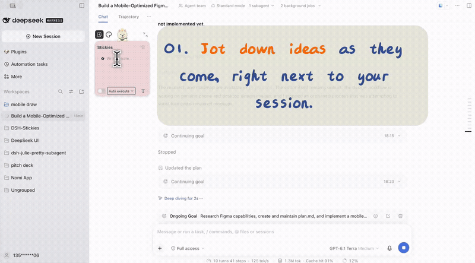

hi, i'm julie, a product designer.

building warm, inclusive things that make everyone feel a little more creative, and a little more themselves.

[X @JulieZ1122](https://x.com/JulieZ1122) · [portfolio](https://luhan.juliezhang1122.chatgpt.site/)

---

### [My Cozy DSH](https://github.com/juliiiiiiiu/my-cozy-dsh)

a warm hand-drawn little room for DeepSeek Harness, with a desk lamp, plants, a sleepy westie and an orange cat keeping you company.
给 DeepSeek Harness 换上一间手绘小屋：台灯、绿植，还有一只打盹的西高地和陪你干活的橘猫。

### [Session Stickies](https://github.com/juliiiiiiiu/session-stickies-manage-your-attention)

> while one session is running, i often think of small fixes, questions, or things to check. if i switch tasks, i forget them. so i built stickies that sit right next to each session.
> — [on x](https://x.com/JulieZ1122/status/2119788368964043160)

给每个会话旁边贴一张便签，切回来时一眼想起它刚才在干嘛。

### [Design Walkthrough](https://github.com/juliiiiiiiu/design-walkthrough)

an agent skill that walks through your UI on web and real phones, collects evidence, runs your lint, and checks the build against the design, so you stop spotting the same UI problems after every coding session.
让 agent 像真人一样走一遍网页和手机真机，收集问题和证据、跑 lint，再拿实现去对设计稿。

> now my design reviews are with an agent at 1am. it never says "looks good"
> — [on x](https://x.com/JulieZ1122/status/2115067102361161934)

### [Photo to Chibi](https://github.com/juliiiiiiiu/Photo-to-Chibi)

make everyone super cute. turn a photo of people into chibi art, with a little live-photo-like motion.
把人像照片变成超可爱的 Q 版小人，还会轻轻动起来。

---

if something here made your day a little nicer, a small ⭐ would make mine too.

如果这里有什么让你开心了一下，给我一颗小星星吧 ⭐
